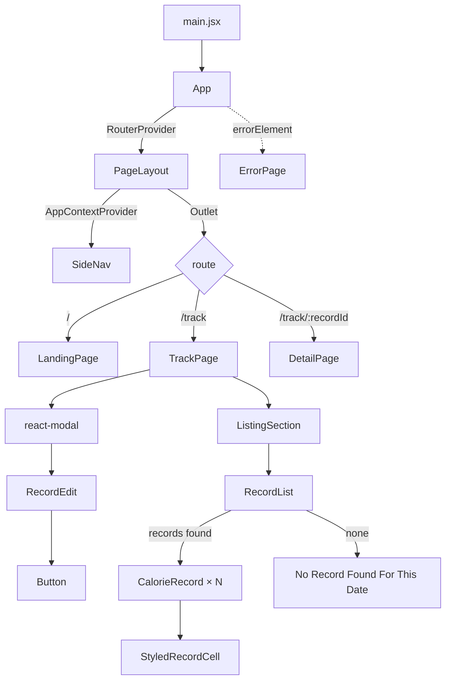
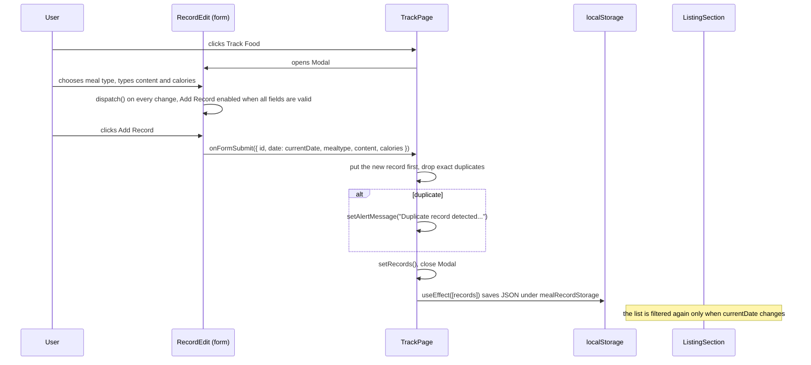

# Calorie Tracker

> A React 19 app for logging what you eat each day. Pick a date, add meals through a validated pop-up form, and watch the day's calorie total update. Workouts count too: type `sport` with negative calories and they are taken off the total. Everything is saved in the browser, so your records are still there after a refresh.


## 🎬 Demo
▶️ **Full walkthrough with voice-over (Egyptian Arabic, 2 min 34 s).** Press play below to watch it with sound:

https://github.com/user-attachments/assets/546a619c-d2a4-4be9-83db-f5e8f93d26d3


---

## Table of Contents

- [Demo](#-demo)
- [About the Project](#about-the-project)
- [Features](#features)
- [Tech Stack](#tech-stack)
- [Getting Started](#getting-started)
  - [Prerequisites](#prerequisites)
  - [Installation](#installation)
  - [Data Storage](#data-storage)
  - [Available Scripts](#available-scripts)
- [Usage](#usage)
- [Project Structure](#project-structure)
- [Architecture](#architecture)
  - [Component Tree](#component-tree)
  - [Routing](#routing)
  - [Adding a Record](#adding-a-record)
  - [Form Validation with useReducer](#form-validation-with-usereducer)
  - [Shared State with Context](#shared-state-with-context)
  - [Filtering by Date](#filtering-by-date)
  - [UI States](#ui-states)
- [Data Model](#data-model)
- [Components Reference](#components-reference)
- [Styling](#styling)
- [Known Limitations and Roadmap](#known-limitations-and-roadmap)
- [Contributing](#contributing)
- [License](#license)
- [Acknowledgments](#acknowledgments)

---

## About the Project

Calorie Tracker is a single-page application with a side menu and four pages: a landing page, the **Track** page where all the work happens, a detail page for each record, and an error page that sends you home by itself. Meals are added through a pop-up form built with [react-modal](https://github.com/reactjs/react-modal) and stored in `localStorage`.

The project is a practical exercise in **core React patterns**:

- **Client-side routing** with nested routes, a shared layout, active links and an error page.
- **Form validation** with `useReducer`, where the validity of one field depends on another.
- **Shared state** with React Context, so deeply nested components can read and update the daily total and the selected date.
- **Effects and cleanup** with `useEffect`: saving to storage, a cancellable loading timer, and a countdown that clears its own interval.
- **Refs** with `useRef` to read form values and move the focus to a field.

---

## Features

| Area | What you can do |
| --- | --- |
| **Daily log** | See every meal of the selected day with its date, meal type, content and calories |
| **Pick a day** | Choose any date with **Select Date**. The list shows only that day's meals |
| **Add a meal** | Click **Track Food** to open a pop-up form: date, meal type (Breakfast, Lunch, Dinner, Snack), content and calories |
| **Live validation** | Invalid fields turn red, and **Add Record** stays disabled until every field is valid |
| **Workout rule** | Negative calories are accepted only when the content is `sport`, so a workout is subtracted from the total |
| **Auto focus** | If the content field is emptied, the cursor jumps back to it |
| **Duplicate protection** | Adding the exact same record twice is refused with a message |
| **Daily total** | **Total Calories Count** under the list, and an orange banner at the top of the form, show the day's total |
| **Saved in the browser** | Records are kept in `localStorage` and come back after a refresh |
| **Record page** | Click a record to open its own page, then **Back to the list** to return |
| **Error page** | An unknown URL shows an error page that counts down from 10 and returns to the home page |
| **Side menu** | **Home** and **Track** links, with the current page highlighted |

---

## Tech Stack

| Category | Library | Purpose |
| --- | --- | --- |
| UI | [React 19](https://react.dev/) | Component library |
| Language | JavaScript (ES2022+, JSX) | Application code |
| Build tool | [Vite 8](https://vite.dev/) | Dev server with HMR and production bundler |
| Compiler | [React Compiler](https://react.dev/learn/react-compiler) (`babel-plugin-react-compiler` through `@rolldown/plugin-babel`) | Automatic memoization at build time |
| Routing | [React Router 7](https://reactrouter.com/) (`react-router-dom`) | `createBrowserRouter`, nested routes, `NavLink`, `useParams`, `useNavigate` |
| Modal | [react-modal](https://github.com/reactjs/react-modal) | Accessible pop-up for the Add Record form |
| State | React hooks | `useState`, `useReducer`, `useContext`, `useEffect`, `useRef`, `useCallback` |
| Styling | [CSS Modules](https://github.com/css-modules/css-modules) | Component-scoped styles, plus CSS variables in `index.css` |
| Linting | [Oxlint](https://oxc.rs/docs/guide/usage/linter.html) | Fast linter with React and hooks rules |
| Storage | Browser `localStorage` | Keeps records between visits |

---

## Getting Started

### Prerequisites

- **Node.js** `20.19+` or `22.12+`. Vite 8 needs one of these versions.
- **npm**, which comes with Node.js.

### Installation

```bash
# 1. Clone the repository
git clone https://github.com/Abdallaheng2022/<repo-name>.git
cd <repo-name>

# 2. Install dependencies
npm install

# 3. Start the development server
npm run dev
```

Then open the URL printed in the terminal (usually <http://localhost:5173>).

### Data Storage

There are no environment variables and no back end. Records are saved in the browser's `localStorage` under one key:

| Key | Holds |
| --- | --- |
| `mealRecordStorage` | A JSON array of every record (see [Data Model](#data-model)) |

> **Start over:** open the browser's developer tools, go to **Application → Local Storage → http://localhost:5173**, delete `mealRecordStorage`, and refresh. Storage belongs to one browser on one device, so records don't follow you to another browser.

### Available Scripts

| Command | Description |
| --- | --- |
| `npm run dev` | Starts the Vite dev server with Hot Module Replacement |
| `npm run build` | Builds an optimised production bundle into `dist/` |
| `npm run preview` | Serves the production build from `dist/` locally |
| `npm run lint` | Runs Oxlint on the project |

---

## Usage

1. **Start.** The app opens on the home page. Click **Start Tracking**, or **Track** in the side menu.
2. **Pick a day.** Choose a date in **Select Date**. Today is selected by default. After a short loading delay, the list shows that day's meals, or *No Record Found For This Date*.
3. **Add a meal.** Click **Track Food**, choose the meal type, type the content and the calories, then click **Add Record**. To log a workout, type `sport` as the content and a negative number of calories, for example `-200`.
4. **Check the total.** Read **Total Calories Count** under the list. It adds every meal and subtracts every workout of the day.
5. **Open a record.** Click any record to open its page, then **Back to the list**.
6. **Close the form** with the **Escape** key or by clicking outside it.

---

## Project Structure

```text
calories-tracker/
├── docs/
│   └── demo.gif                    # Animated demo shown at the top of this README
├── public/
│   ├── favicon.svg                 # Browser tab icon
│   └── icons.svg                   # SVG sprite (from the Vite template)
├── src/
│   ├── assets/                     # Images from the Vite template (not used by the app)
│   ├── components/
│   │   ├── AppContext.jsx          # Context + provider: currentDate and totalCalories
│   │   ├── Button.jsx              # Small button wrapper that passes props through
│   │   ├── CalorieRecord.jsx       # One record row; adds its calories to the daily total
│   │   ├── CalorieRecordDate.jsx   # Date cell: month, day, year (not currently rendered)
│   │   ├── ListingSection.jsx      # Date picker + filtered list (simulated 5 s loading)
│   │   ├── RecordEdit.jsx          # Add Record form, validated with useReducer
│   │   ├── RecordList.jsx          # List of records, empty placeholder and daily total
│   │   ├── SideNav.jsx             # Side menu with Home and Track NavLinks
│   │   ├── StyledRecordCell.jsx    # Rounded cell wrapper used in each record row
│   │   └── *.module.css            # Styles for each component (CSS Modules)
│   ├── pages/
│   │   ├── DetailPage.jsx          # /track/:recordId, shows the record ID
│   │   ├── ErrorPage.jsx           # Error page with a 10-second countdown to home
│   │   ├── LandingPage.jsx         # / , welcome text and Start Tracking link
│   │   ├── PageLayout.jsx          # Shared layout: context provider, side menu, <Outlet />
│   │   ├── TrackPage.jsx           # /track, records state, modal, localStorage, duplicates
│   │   ├── *.module.css            # Page styles (CSS Modules)
│   │   └── index.js                # Barrel file that re-exports every page
│   ├── App.jsx                     # Router definition and <RouterProvider />
│   ├── App.module.css              # App-level styles
│   ├── index.css                   # CSS variables (theme colours, radius, list width)
│   └── main.jsx                    # Entry point: Modal.setAppElement("#root"), <App /> in <StrictMode>
├── .gitignore                      # Ignores node_modules, dist and *.local
├── .oxlintrc.json                  # Oxlint rules (rules-of-hooks, only-export-components)
├── index.html                      # HTML shell; Vite injects the bundle here
├── jsconfig.json                   # Editor settings for JSX
├── package.json                    # Dependencies and npm scripts
└── vite.config.js                  # React plugin and React Compiler (Babel)
```

---

## Architecture

### Component Tree



`PageLayout` wraps every page in `AppContextProvider`, so the side menu and all pages share the same selected date and daily total. `TrackPage` owns the list of records and passes it down as `AllRecords`.

### Routing

The router is created once in `App.jsx` with `createBrowserRouter`:

| Path | Element | Notes |
| --- | --- | --- |
| `/` | `PageLayout` | Shared layout for every page below. `errorElement: <ErrorPage />` |
| `/` (index, `path: ""`) | `LandingPage` | Welcome text and a **Start Tracking** link |
| `/track` | `TrackPage` | The tracker |
| `/track/:recordId` | `DetailPage` | Reads `recordId` with `useParams()` and links back with `<Link to=".." relative="path">` |
| anything else | `ErrorPage` | Counts down from `REDIRECT_COUNT = 10`, then calls `navigate("/")` |

`SideNav` uses `NavLink`, so the link of the current page gets the `active` class (light purple). The **Home** link uses `end`, so it is active only on `/` and not on every page below it.

### Adding a Record



On first load, `TrackPage` reads `mealRecordStorage` with a lazy initializer, `useState(loadRecords)`. `loadRecords` turns each saved `date` string back into a `Date` and each `calories` value back into a number. If the key is missing or the JSON is broken, it returns an empty list.

### Form Validation with useReducer

The form keeps one boolean per field in a reducer. A field turns red while its value is `false`, and **Add Record** is enabled only when all four are `true`:

| Field | Valid when | Checked on |
| --- | --- | --- |
| `date` | A date is selected (true from the start) | `change`. Also updates the shared `currentDate` |
| `mealtype` | Not empty | `blur` |
| `content` | Not empty. Also re-checks the calories rule below | `change` |
| `calories` | `>= 0` and content is not `sport`, **or** `< 0` and content is `sport` | `change` |

Why `useReducer`: `content` and `calories` depend on each other. Typing `sport` can make a negative number valid, and typing a negative number can make the content invalid. Each action sends the field's value plus the *other* field's current value (`auXvalue`, read through a ref), and the reducer decides both results in one place.

A `useEffect` watches the four flags. It updates `IsValid`, and when `content` becomes invalid it moves the focus back to the content field with `contentRef.current.focus()`.

### Shared State with Context

`AppContext` holds two values that many components need:

| Value | Used by | Why it is shared |
| --- | --- | --- |
| `currentDate` | `ListingSection` (date picker and filter), `RecordEdit` (date field and the new record's date) | Changing the date in either place updates the other |
| `totalCalories` | `RecordList` (Total Calories Count), `RecordEdit` (orange banner) | It is built by `CalorieRecord`, which sits several levels deeper |

How the total is built: each `CalorieRecord` adds its own calories to the total in a `useEffect`, and its cleanup function subtracts them again. When a row leaves the screen, or React runs effects twice in `<StrictMode>`, the cleanup keeps the total correct.

### Filtering by Date

`ListingSection` keeps its own `filteredRecords` state. A `useEffect` that depends on `[currentDate]`:

1. Starts a **5-second `setTimeout`** that simulates loading data from a server.
2. When the timer fires, it keeps only the records whose day, month and year match `currentDate`.
3. Returns a cleanup function that **clears the timer**. If the user picks another date before the 5 seconds are up, the old timer is cancelled and only the latest date is applied.

### UI States

| State | Condition | What is shown |
| --- | --- | --- |
| Loading | First 5 seconds after the date changes | The previous list, or *No Record Found For This Date* on first load |
| Records | `filteredRecords.length > 0` | One `CalorieRecord` row per meal, each a link to its detail page |
| Empty | No record on that day | *No Record Found For This Date* |
| Form invalid | Any field flag is `false` | Red fields and a disabled **Add Record** button |
| Duplicate | The submitted record already exists | *Duplicate record detected. The record will not be added.* |
| Unknown URL | No route matches | *Something goes wrong...* and a countdown to the home page |

---

## Data Model

Each record looks like this in memory:

```js
{
  id:       "c7397974-d528-4a53-afba-fe8c78dbbefa", // crypto.randomUUID()
  date:     Date,          // the selected date when the record was added
  mealtype: "Breakfast",   // "Breakfast" | "Lunch" | "Dinner" | "Snack"
  content:  "Eggs",        // free text; "sport" marks a workout
  calories: 340,           // number; negative only when content is "sport"
}
```

In `localStorage`, `date` is saved as an ISO string, for example `"2026-11-23T16:18:04.512Z"`, and turned back into a `Date` on load.

**Duplicate rule.** Two records are duplicates when `date` (to the millisecond), `mealtype`, `content` and `calories` are all equal. The `id` is not compared.

---

## Components Reference

| Component | Props | Description |
| --- | --- | --- |
| `App` | — | Creates the router and renders `<RouterProvider />` |
| `PageLayout` | — | Wraps the pages in `AppContextProvider` and renders `SideNav` and `<Outlet />` |
| `LandingPage` | — | Welcome text and a **Start Tracking** link to `/track` |
| `TrackPage` | — | Holds `records`, `alertMessage` and `IsModalOpen` state. Loads and saves `localStorage`, refuses duplicates, and renders the modal, the list and the **Track Food** button |
| `DetailPage` | — | Shows `recordId` from the URL and a link back to the list |
| `ErrorPage` | — | Shows an error and counts down from 10 with `setInterval` (stored in a ref), then navigates home |
| `AppContextProvider` | `children` | Provides `currentDate`, `setCurrentDate`, `totalCalories` and `setTotalCalories` |
| `SideNav` | — | Title, **Home** and **Track** `NavLink`s with an active style |
| `ListingSection` | `AllRecords` | Date picker and the date filter with a 5-second simulated delay |
| `RecordList` | `records` | The list of rows, or the empty placeholder, plus **Total Calories Count** |
| `CalorieRecord` | `date`, `mealtype`, `content`, `calories` | One row. Adds its calories to the shared total and removes them in cleanup |
| `RecordEdit` | `onFormSubmit(record)`, `onCloseForm()` | The validated Add Record form with the total-calories banner |
| `Button` | `type`, `children`, any `<button>` prop | Passes everything to a native `<button>` |
| `StyledRecordCell` | `children` | Rounded cell used for the date and calories |
| `CalorieRecordDate` | `date` | Month, day and year cell (currently not rendered) |

---

## Styling

- **CSS Modules** (`*.module.css`) keep each component's class names local, imported as `styles["class-name"]`.
- **`index.css`** defines the theme as CSS variables: purple `--theme-color-normal: #8458b3`, light purple `--theme-color-light: #d0bdf4`, dark grey `--theme-color-dark: #494d5f`, light blues for backgrounds, `--theme-border-raduis-smooth: 10px` and `--theme-width-record-list: 63%`.
- **Form states:** invalid fields get a maroon border and text, the total banner is orange, and a disabled button turns light grey and ignores clicks (`pointer-events: none`).
- **react-modal** gets inline styles: centred with `transform`, no border or padding, rounded corners and a 50% black overlay. `Modal.setAppElement("#root")` in `main.jsx` hides the rest of the page from screen readers while the form is open.
- **Layout:** the side menu takes 20% of the width. The date picker row is a fixed 950 px wide.

---

## Known Limitations and Roadmap

- [x] Routing with a shared layout, active links, a detail page and an error page
- [x] Add Record form with `useReducer` validation and the `sport` rule
- [x] Daily total shared through Context
- [x] Records saved in `localStorage`
- [x] Duplicate protection
- [ ] Refresh the list right after **Add Record**. The filter effect in `ListingSection` depends only on `[currentDate]`, so a new record appears only after the date changes or the page is refreshed. Add `AllRecords` to the dependency list
- [ ] Use each record's own `id` in `RecordList`. One `crypto.randomUUID()` is made per render and used as the `key` and link of every row, so all rows share one key and the detail page receives a random ID
- [ ] Show the record's details (meal, content, calories) on `DetailPage`, not only its ID
- [ ] Style the `.alert` message. The class has no CSS, so the duplicate warning sits partly hidden under the side menu
- [ ] Let **Cancel** close the form at any time. Right now it closes only when the form is valid, and it calls `event.preventDefault()` on the global `event` instead of a parameter
- [ ] Require a calories value. Typing the content also re-checks calories with `Number("") === 0`, so **Add Record** turns on while the calories field is still empty and the meal is saved with 0 calories
- [ ] Compare dates by day in the duplicate check. The full timestamp is compared, so the same meal added after a refresh is not caught
- [ ] Fill the date inputs from the local date. `toISOString()` gives the UTC date, so between midnight and 03:00 in UTC+3 (for example Istanbul) the picker shows the previous day
- [ ] Remove the 5-second simulated delay, or replace it with a real request
- [ ] Remove or finish the `randomapi.com` user request in `ListingSection`. Its result is not used for anything visible
- [ ] Edit and delete records
- [ ] Remove unused packages (`react-model`, `style-components`, and `styled-components`, which appears only in a commented-out example) and unused code (`CalorieRecordDate`, the `memo` import in `Button`)
- [ ] Responsive layout for small screens (the date picker row is a fixed 950 px)
- [ ] Unit tests (Vitest + React Testing Library)
- [ ] Remove unused Vite template assets (`hero.png`, `react.svg`, `vite.svg`)

---

## Contributing

Contributions, issues and feature requests are welcome.

1. Fork the project.
2. Create a feature branch: `git checkout -b feature/my-feature`
3. Commit your changes: `git commit -m "feat: add my feature"`
4. Make sure `npm run lint` and `npm run build` pass.
5. Push the branch: `git push origin feature/my-feature`
6. Open a Pull Request.

---

## License

No license has been chosen yet. Until one is added, all rights are reserved by the author. To make the project open source, add a `LICENSE` file (for example [MIT](https://choosealicense.com/licenses/mit/)) and update this section.

---

## Acknowledgments

- [React Router](https://reactrouter.com/) for client-side routing
- [react-modal](https://github.com/reactjs/react-modal) for the accessible pop-up
- [Vite](https://vite.dev/) and [Oxlint](https://oxc.rs/) for the tooling
